# Normal

**Find the business problem. Check the evidence. Approve the next step.**

A small ecommerce business can see that sales have fallen. Finding the reason usually means moving between advertising reports, orders, delivery updates and customer feedback, then deciding what to do with incomplete information.

We built Normal to bring that work into one place. It watches business activity, groups unusual changes into an investigation, uses Mubit to compare possible explanations, and proposes a response that a person can review. Approved actions run through restricted tools, with a saved record of what changed.

Our hackathon demonstration uses an **unaffiliated Nike shop simulation**. The orders, customers, advertising activity and deliveries are synthetic. The model requests, database records, validation checks and recorded changes described below are genuine development/demo results. Nothing here changes a real advertising account, sends a real customer email or takes a real payment.

## Start here

If you have two minutes, follow these four pieces of evidence:

1. **The investigation:** [saved Mubit report](docs/stage5-runs/stage5_1792885194280.json) — five model calls, six verified internal evidence records and no unresolved citations.
2. **The proposed response:** [saved planner output and handoff](docs/stage6-runs/advertising-plan.json) — compare alternatives and inspect the exact campaign, amount, evidence and approval requirement.
3. **The result after approval:** [execution audit](docs/stage7-runs/audit.json) — the budget is read back from MongoDB at 6750 GBP minor units, with an action receipt and callback event.
4. **The browser proof:** [recorded browser results](docs/stage7-runs/browser.json) and [budget-after screenshot](docs/stage7-runs/meta-after.png) — the refreshed campaign table shows £67.50/day.

These are connected records, rather than four unrelated examples. The execution demonstration is an isolated copy of the saved investigation and plan; its [copy manifest](docs/stage7-runs/acceptance.json) names the original run, original plan and source hash. It does **not** claim a new model call during execution.

**Evidence snapshot:** implementation reviewed at `2436c4b` on `main`; recorded demonstrations are from 24–25 October 2026. Test results below are attributed to their saved verification reports. They are not a claim that the entire current branch has just passed a fresh full regression.

## What the demo shows

The main story follows a deteriorating advertising campaign:

| Step | What happens | Where to inspect it |
| --- | --- | --- |
| Detect | Recorded activity produces an advertising incident. Normal compares the affected period with its baseline. | [Investigation artifact](docs/stage5-runs/stage5_1792885194280.json), [detector](src/intelligence/detection/engine.ts) |
| Investigate | The Mubit investigator checks competing explanations and calls read-only evidence tools. The saved report includes citations and uncertainty. | [Investigator controller](src/intelligence/investigator/controller.ts), [report audit](docs/stage5-runs/report-audit-final.json) |
| Plan | Mubit compares a targeted budget reduction, a broader reduction and further investigation without changes. Deterministic checks reject unsupported proposals. | [Planner artifact](docs/stage6-runs/advertising-plan.json), [planner validation](src/planner/validation.ts) |
| Review | A person approves an exact plan version and selected actions. Approval and execution are separate steps. | [Approval/execution screenshot](docs/stage7-runs/approval-execution.png), [approval route](src/app/api/plans/[id]/approve/route.ts) |
| Execute and check | The approved marketing action changes the simulated campaign budget from **£90 to £67.50/day**. Normal reads the result back and records the receipt and event. | [Audit](docs/stage7-runs/audit.json), [browser record](docs/stage7-runs/browser.json), [execution implementation](src/execution/) |

The campaign is `cmp_basketball_search`. Its proposed 25% reduction is tied to campaign-specific evidence, including zero attributed orders in the observed window. It is a cautious intervention, not a prediction that revenue will recover.

The advertising run's injected scenario was `ad_fatigue`; the investigator selected a qualified `ad_inefficiency` explanation and retained alternatives. We do not count this as an exact root-cause match or a definitive causal finding. The distinction is visible in the saved report's metrics and hypotheses.

A second demonstration checks coordinated customer care: a **labelled shipping test fixture** approves delay notices before a factual storefront banner. The audit records two messages in the demo inbox and the banner on the simulated store. This proves ordered execution and read-back; it is not a fresh live shipping diagnosis. [Shipping fixture](docs/stage7-runs/shipping-fixture.json) · [audit](docs/stage7-runs/audit.json) · [visible banner](docs/stage7-runs/nike-banner.png).


## How we use Mubit

Mubit sits on the actual investigation and planning paths. The investigator forms and revises hypotheses, requests evidence and produces structured diagnosis output. The planner uses the validated diagnosis and scoped evidence to compare responses. The app validates model output before publishing a diagnosis or creating a proposed plan.

The [provider](src/intelligence/investigator/provider.ts) routes requests through `api.mubit.ai`; the [planner service](src/planner/service.ts) reuses that provider and its call records. The recorded investigation and planning work uses `gpt-6-luna`; the optional research route supports `gemini-4-argon`. Models are configurable in [.env.example](.env.example).

| Recorded task | Evidence of actual requests | Result and boundary |
| --- | --- | --- |
| Advertising investigation | Five request IDs in [the saved run](docs/stage5-runs/stage5_1792885194280.json), beginning `mreq_01a1704a2da17a43bcdbc66d3a46f3d2`; **30,477 reported tokens** | Completed, qualified diagnosis; six verified evidence records, four cited records, zero unresolved citations. |
| Checkout investigation | Three request IDs in [the saved checkout run](docs/stage5-runs/s5eval_1792881375759_0_0.json); **11,735 reported tokens** | Completed `discount_failure` diagnosis on held-out seed 11; two evidence records, four citations, zero invalid citations. One scenario result, not a general accuracy score. |
| Advertising strategy generation | `mreq_01a170a09c2c775184fffe17575bd54c`, with earlier attempts preserved in [the planning record](docs/stage6-runs/advertising-plan.json) | A valid targeted proposal was selected. The broader reduction was blocked when its individual targets lacked sufficient support. |
| External-source check | Discovery and passage-assessment IDs in [the source acceptance record](docs/stage5-runs/source_acceptance_1792885169199.json) | A narrow Nike employee-note claim was supported; an unsupported Google Ads outage claim was not. This was a separate source check, not causal evidence for the advertising incident. |

Task fingerprints separate stable instructions/schema/tool definitions from changing case inputs. Saved calls retain request IDs, reported usage, input checksums and outputs so a reviewer can follow the work. Provider errors and ambiguous billable requests are recorded rather than silently replayed. See [provider tests](tests/investigator/provider.test.ts) and [investigation validation tests](tests/investigator/validation.test.ts).

For the hackathon configuration, keep `NORMAL_DIRECT_GEMINI_FALLBACK=false`; the optional direct-provider fallback must remain off so research requests also stay on Mubit.

**Adapter training is an ambition, not a measured result in this branch.** Repeated task traffic and call records are present, but we have no linked proof here of a passing adapter serving these tasks or improving held-out quality, cost or latency. Local correction records do not establish that Mubit accepted feedback into training. Mubit describes its review, training and testing process in the [official adapter guide](https://docs.mubit.ai/guides/first-adapter). We will report an adapter result only with its task/version, test outcome and a reproducible comparison.

## Evidence you can check

The linked JSON files contain the underlying records; the verification reports explain how they were obtained and what they do not establish.

| Claim | Evidence | What it proves |
| --- | --- | --- |
| The saved advertising report is internally consistent. | [Report audit](docs/stage5-runs/report-audit-final.json) | **13/13 checks passed**, including diagnosis, brief, citations, impact reference, request attribution and a non-executable investigation handoff. This is consistency, not causal truth. |
| Planning does not itself change the business. | [Stage 6 preservation result](docs/stage6-runs/preservation-after.json), [planner tests](tests/planner/validation.test.ts) | Planning created proposals without receipts, notices, banners or budget changes. |
| An approved budget change was persisted and verified. | [Execution audit](docs/stage7-runs/audit.json), [browser results](docs/stage7-runs/browser.json), [before](docs/stage7-runs/meta-before.png) / [after](docs/stage7-runs/meta-after.png) | £90 → £67.50/day, one durable receipt and a verified budget callback; the browser checked the result after refresh. |
| Unsafe or repeated execution is rejected. | [Execution integration tests](tests/execution/integration.test.ts), [Stage 7 report](docs/stage7-verification.md) | Checks cover missing approval, wrong scope/version, changed targets, expired approval, altered parameters, dependencies and duplicate requests. |
| Shipping actions respect their order. | [Shipping fixture](docs/stage7-runs/shipping-fixture.json), [execution audit](docs/stage7-runs/audit.json) | Two demo notices followed by a factual banner, with saved receipts and callbacks. |
| The storefront reads persisted product data. | [Browser results](docs/stage7-runs/browser.json), [storefront screenshot](docs/stage7-runs/nike-storefront.png), [browser test](tests/e2e/stage7-partner.spec.ts) | 17 products, 141 local images, decoded catalogue images, filtering, a second detail image and one persisted simulated checkout order. |
| Public-source cards distinguish support from speculation. | [Source records](docs/stage5-runs/source_acceptance_1792885169199.json), [integration browser record](docs/stage5-runs/source-card-integration-browser.json) | Genuine source discovery/retrieval and positive/negative claim checks; the final source-card integration used an explicitly file-backed report fixture. Spontaneous research within a relevant live investigation remains unverified. |
| Existing demonstration data was preserved. | [Stage 7 before](docs/stage7-runs/preservation-before.json) / [after](docs/stage7-runs/preservation-after.json), [verification report](docs/stage7-verification.md) | Hashes match across 39 original collections outside the new isolated acceptance scopes; active selection remained `demo_nike`. |

### Detector evaluation

The [committed detector evaluation](docs/evaluation/detection-evaluation.json) records 15 seeded runs for each scenario, with separate development and held-out groups. This evaluates detection on synthetic activity; it does not measure Mubit diagnosis accuracy or prove performance on a real shop.

| Synthetic scenario | Detected | Opened an investigation-worthy incident |
| --- | ---: | ---: |
| Advertising fatigue | 15/15 | 15/15 |
| Delivery delays | 15/15 | 15/15 |
| Viral demand | 15/15 | 15/15 |
| Promotional checkout failure | 15/15 | 1/15 |
| Negative reviews | 5/15 | 4/15 |

Across the 15 healthy runs, one incident was recorded. Checkout escalation and sparse negative-review detection remain clear weaknesses in this evaluation. The exact seeds, scenario durations and results are included so those limits are inspectable.

### Recorded software checks

| Scope | Recorded result | Source |
| --- | --- | --- |
| Stage 5 source/evidence/card checks | **64/64 focused tests**, plus **1/1** desktop source-card integration test | [Stage 5 verification](docs/stage5-verification.md) |
| Stage 6 planner | **21/21 focused tests**, plus **1/1** desktop planning acceptance | [Stage 6 verification](docs/stage6-verification.md) |
| Stage 7 approval/execution and partner interfaces | **31 focused tests**, plus **1/1** desktop production-build acceptance; no browser page errors | [Stage 7 verification](docs/stage7-verification.md) |
| Contracts | Typechecking and **15/15** examples passed in the Stage 7 verification | [Shared contracts](packages/contracts/README.md), [Stage 7 verification](docs/stage7-verification.md) |
| Stage 7 build/static checks | Production build and TypeScript passed; ESLint had **0 errors and 14 warnings** | [Stage 7 verification](docs/stage7-verification.md) |
| Full regression | **307/307 across 52 files** is the previous complete baseline. A later run reached **319/320**; a focused repair passed, but the subsequent full rerun was interrupted. A current full-suite pass remains unestablished. | [Full history and limitations](docs/stage5-verification.md#focused-verification-policy-and-latest-results) |

The focused test counts overlap in places and should not be added together. Earlier desktop/mobile checks do not establish complete mobile coverage for the later planning and execution integration.

## Architecture

```mermaid
flowchart LR
    A[Business activity] --> B[Validated event ledger]
    B --> C[Metrics and detection]
    C --> D[Investigation and read-only evidence]
    D --> E[Mubit investigator]
    E --> F[Validated diagnosis with citations]
    F --> G[Mubit solution planner]
    G --> H[Validated proposed plan]
    H --> I[Human approval of exact version]
    I --> J[Restricted execution agents]
    J --> K[Simulated ads, inbox and storefront]
    K --> L[Read-back verification and callback events]
    L --> B
```



MongoDB is the shared source of truth for events, evidence, reports, proposals, decisions and execution records. The detector and evidence tools use allowed observations rather than hidden scenario labels. The [data-boundary test](tests/intelligence/leakage.test.ts) checks those module boundaries. The planner can read scoped current target state to validate a proposed action; that is separate from the detector's evidence boundary.

The application uses Next.js/React, TypeScript, MongoDB and the shared Zod-based [contracts package](packages/contracts/README.md). Useful code entry points are [monitoring](src/intelligence/monitoring/), [evidence tools](src/intelligence/evidence/tools/), [investigation](src/intelligence/investigator/), [planning](src/planner/), [execution](src/execution/) and [adapters](src/adapters/). The [API guide](docs/api.md), [MongoDB notes](docs/mongodb.md) and [partner integration guide](docs/partner-integration.md) describe the interfaces. Older roadmap sections in those documents are historical; the Stage 5–7 reports above record the later implementation.

<details>
<summary>Original product architecture illustration</summary>

This illustration describes the broader product direction. The implemented flow and remaining limits are stated above and below.


</details>

## Run Normal locally

You need Node.js 22 or newer, npm, MongoDB Atlas or another MongoDB replica set, and a Mubit key with access to the configured models. Transactions and Change Streams need a replica set. The saved JSON reports can be reviewed without a database or provider account.

```sh
npm ci
cp .env.example .env.local
```

Set `MONGODB_URI`, `MONGODB_DB` and `MUBIT_API_KEY` in `.env.local`. Keep credentials out of Git. Start the app:

```sh
npm run dev -- --port 3000
```

In separate terminals, from the same repository, start the workers for the paths you want to exercise:

```sh
npm run monitor:watch
npm run investigator:work
npm run planner:work
```

Open `/dev/simulator` to create a fresh named simulation run, advance its clock and inject a scenario. Use its run ID consistently in dashboard links. `/dev/monitor` shows monitoring progress. Investigations and planning require their workers; queued work will not complete from the web page alone.

The main routes are `/dashboard`, `/dashboard/signals`, `/dashboard/investigations`, `/dashboard/approvals` and `/dashboard/activity`. `/ads` shows the simulated campaign account; `/demo-store` and `/store` show the simulated shop. `/shopify` is a separately labelled synthetic introduction with no live Shopify connection.

### Reproduce or inspect the evidence

For a fresh isolated advertising investigation, the existing script creates a new run without changing active selection, requests Mubit output and writes a report:

```sh
npm run demo:stage5
```

This makes paid/provider-credit model requests and writes a fresh isolated demo scope. Its output includes the run ID and investigation workspace URL. Completion depends on provider availability; a failed provider call must remain a failed/provisional result.

If the recorded acceptance runs are present in your configured database, the following rechecks their saved state without approving, executing or making a model request:

```sh
node --conditions=react-server --import tsx scripts/audit-stage7.ts
node --conditions=react-server --import tsx scripts/stage7-preservation.ts
```

These scripts refresh their local audit reports. They do not recreate records from JSON on an empty database. To prepare a fresh execution demonstration, see [the Stage 7 procedure](docs/stage7-verification.md); its advertising copy preserves the source plan's expiry and deliberately fails after that plan expires. Use a new eligible plan rather than extending an old approval.

For checks, run:

```sh
npm run contracts:typecheck
npm run contracts:validate
npm run typecheck
npm run lint
npm test -- tests/investigator/provider.test.ts tests/investigator/validation.test.ts tests/planner/validation.test.ts
```

`npm run verify` also runs the full database-backed suite. Use a dedicated test database and allow for the long simulator evaluations. Browser tests use `npm run test:e2e`; live-model and Stage 7 acceptance cases have their own setup and existing-record requirements, documented in the verification reports. They are not a one-command fresh-database replay.

## What is real, simulated, and still unfinished

- **Implemented:** persisted monitoring and evidence, Mubit investigation and planning, exact-version human review, restricted execution, receipts and read-back verification.
- **Simulated:** customer activity, ad accounts, campaign effects, orders, delivery activity, inbox messages, purchases and storefront operations. The Shopify introduction is a separate presentation fixture.
- **Public reference material:** cited product information and contextual company sources. These describe the real brand; they do not establish the cause of a simulated business incident. See [data provenance](docs/data-provenance.md). Stage 7's local product-image implementation is documented in [its verification report](docs/stage7-verification.md).
- **Still unfinished:** production identity/roles, an always-on execution recovery worker, measured later business impact, and a verified correction-to-adapter improvement loop. Provider cost remains unknown because rates are not configured. External research is optional and its combined spontaneous live-investigation acceptance remains unverified.

Action read-back confirms that a budget, message or banner changed as approved. It does not prove that revenue improved afterward. Interrupted or ambiguous actions require review; they are not automatically retried. Unsupported actions remain disabled or advisory.

The intended next step is to measure later outcomes and use verified corrections to evaluate task-specific models. We have kept that future work separate from the evidence of what this submission already does.

## Further evidence and project context

- [Stage 4 implementation and historical verification](docs/implementation-report.md)
- [Stage 5 investigation verification and limitations](docs/stage5-verification.md)
- [Stage 6 planning verification](docs/stage6-verification.md)
- [Stage 7 approval/execution verification](docs/stage7-verification.md)
- [Data dictionary](docs/data-dictionary.md) and [simulation state](docs/simulator-state.md)
- [Official Mubit documentation](https://docs.mubit.ai/) and [Night Shift brief and judging criteria](https://luma.com/nightshift-london)
- [Repository contributors](https://github.com/OactoDev/Normal/graphs/contributors)
